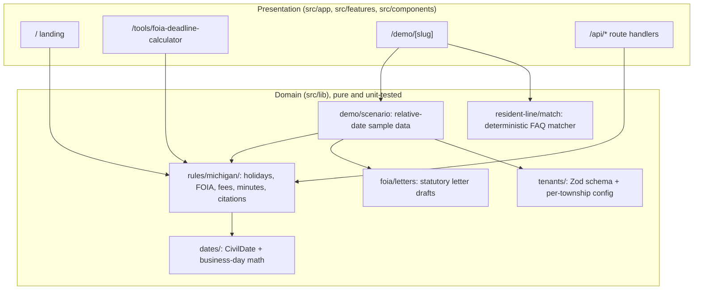
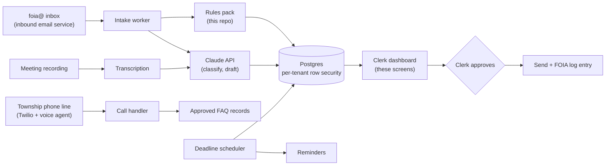

# Architecture

This repository ships two things from one Next.js app:

1. **The public site:** the landing page and the free Michigan FOIA deadline calculator.
2. **Prospect demos:** a private, personalized link per township (`/demo/<slug>`) that shows
   that township's own week, handled.

It is also the foundation of the production product. The rules engine, tenant model, and UI
components are the ones the live Township Clerk Agent will use. Only the data sources change:
in production they are real inboxes, recordings, and phone calls instead of seeded samples.

## Layers

**Rule of the codebase:** components never compute deadlines. Every date the UI shows comes
from a pure function in `src/lib/rules/`, and every such function has a test with a real
calendar example.

## Request flow for a demo

1. `src/proxy.ts` runs first for `/demo/*`. If `DEMO_ACCESS_KEY` is set, it checks the access
   cookie or the `?key=` parameter.
2. `app/demo/[slug]/page.tsx` calls `connection()` so the page renders per request, then
   resolves the tenant from the registry (404 if unknown).
3. `todayIn("America/Detroit")` gives Michigan's current date regardless of the server's zone.
4. `buildDemoScenario(tenant, today)` creates sample FOIA requests a few business days old,
   computes their legal deadlines, estimates fees, and drafts letters. The latest regular
   board meeting is found from the tenant's meeting rule (e.g. the 2nd Monday).
5. The serializable scenario is handed to the client `DemoApp`, which handles tabs, selection,
   approvals, and the resident-line conversation.
6. Engagement beacons go to `POST /api/events` and land in structured logs.

## Key design decisions

| Decision                                          | Why                                                                                 | Record                                     |
| ------------------------------------------------- | ----------------------------------------------------------------------------------- | ------------------------------------------ |
| Legal dates are `CivilDate` strings, not `Date`   | Deadlines are calendar days; this removes time-zone and DST bugs                    | [ADR 0001](adr/0001-civil-dates.md)        |
| State law lives in a versioned rules pack         | Expansion to a new state is a new pack, not a rewrite; legal changes are reviewable | [ADR 0002](adr/0002-state-rules-packs.md)  |
| The demo is deterministic, with no LLM at runtime | A prospect must never see an invented answer; demos must be free to run             | [ADR 0003](adr/0003-deterministic-demo.md) |
| Tenants are typed config validated at build       | Onboarding is configuration plus review; a bad config fails CI, not a demo          | `src/lib/tenants/schema.ts`                |

## Production target architecture

The demo is the front end of the product described in the go-to-market plan. The production
system adds these services behind the same domain layer:

The constraint that carries over unchanged: **the agent drafts, a named official approves.**
No path from an LLM output to a resident or requester bypasses the approval step.
